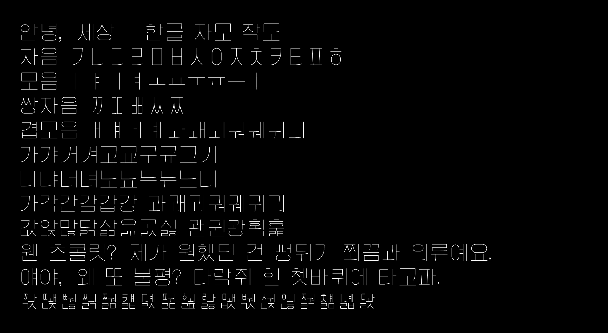
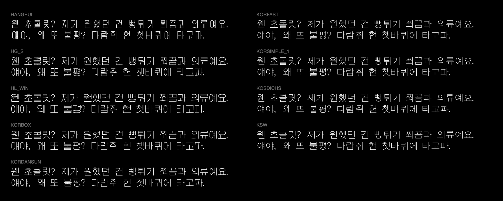

# Hangeul Monoline Fonts

*This directory presents a collection of monoline Hangeul fonts and the tools used to inspect, compose, and export them. Most of the source files were originally developed in the 1980s-1990s for CAD programs; the canonical versions of these fonts are in AutoCAD SHX format, and are maintained in [`shx_sources/`](shx_sources/). These have also been converted into JSON and SVG 1.1 font formats. The directory includes p5.js programs for constructing Hangeul characters from their jamo components.*

---

## About Hangeul

<!--  -->

Hangeul is built from **jamo**, the individual consonant and vowel letters of the Korean writing system. Modern Hangeul has 24 basic letters (14 consonants and 10 vowels), conventionally expanded to 40 forms (19 consonants and 21 vowels) when doubled consonants and compound vowels are included. In ordinary Korean writing, these letters are arranged into approximately square blocks representing syllables, rather than written in a linear sequence. A modern Hangeul syllable block consists of an initial consonant (*choseong*, 초성), a medial vowel (*jungseong*, 중성), and an optional final consonant or consonant cluster (*jongseong*, 종성).

Unicode assigns **11,172 code points** to precomposed modern Hangeul syllables (`U+AC00` through `U+D7A3`). This number comes from a combinatorial enumeration: `19 initials × 21 vowels × 28 final configurations = 11,172 syllables`. The 28 final configurations include the absence of a final consonant. Many of the resulting syllables are uncommon or absent from ordinary Korean vocabulary, but all are structurally possible in the modern writing system.

Older Korean computer fonts often contain a smaller **Wansung** (완성형, *completed-form*) repertoire of 2,350 precomposed syllables. This set was standardized in the 1987 revision of KS C 5601 (originally established in 1974 and later renamed KS X 1001), for practical Korean computing when memory and storage space were limited. An SHX font containing these 2,350 syllables can therefore be considered complete with respect to that historical repertoire, even though it does not cover every possible Unicode syllable.

An alternative approach is **Johab** (조합형, *compositional form*), which encodes a syllable in terms of its initial consonant, vowel, and final consonant. Strictly speaking, Johab is an encoding strategy, not necessarily a rendering strategy: a Johab-encoded syllable can still be drawn using a precomposed glyph, while a Unicode precomposed syllable can be rendered by dynamically composing jamo.

This project uses both precomposed glyphs and algorithmic jamo composition to present a collection of monoline Hangeul fonts:

* **Wansung fonts** preserve the 2,350 precomposed syllables present in the original source SHX files.
* **Johab-derived fonts** provide all 11,172 modern syllables. They preserve the source font's native Wansung glyphs when available and generate the remaining syllables by composing jamo. Here, "Johab" describes the project's compositional approach, rather than a particular character encoding.
* **The jamo compositor** is an economical stroke-based experiment that constructs all 11,172 modern syllables from a comparatively small set of reusable stroke components.

---

## p5.js Programs

* [**`p5_hangeul_compositor`**](p5_hangeul_compositor/sketch.js): a jamo-only test
  sketch. It accepts input from converted SHX files and always composes syllables from jamo.
* [**`p5_hangeul_full`**](p5_hangeul_full/sketch.js): a hybrid Hangeul viewer. It renders pre-composed Wansung glyphs when a source font has them, and falls back to jamo composition for unrepresented syllables. This sketch includes a simple SVG generator for quick typesetting of monoline Hangeul text. 
* [**`p5_hangeul_specimens`**](p5_hangeul_specimens/sketch.js): a compact specimen
  sheet that loads local SVG 1.1 fonts.
* [**`p5_hangeul_svgfonts`**](p5_hangeul_svgfonts/sketch.js): an SVG 1.1 font viewer
  that displays Hangeul from finished SVG 1.1 font files, without running the jamo
  compositor.

---

## Hangeul Monoline SVG 1.1 Fonts

A collection of generated SVG 1.1 monoline Hangeul fonts can be found in
[`p5_hangeul_svgfonts/svg_fonts/`](p5_hangeul_svgfonts/svg_fonts/). They preserve Unicode code points, allowing Korean text to be rendered by software that supports the [SVG 1.1 font specification](https://www.w3.org/TR/SVG11/fonts.html). These SVG 1.1 font files represent two kinds of Hangeul typefaces:

* **Wansung (완성형):** 2,350 native completed-form syllables from the source SHX files. These are useful for much ordinary Korean text, but technically incomplete for modern Unicode coverage.
* **Johab-derived (조합형):** A complete set of 11,172 modern Hangeul syllables. The 2,350 native Wansung glyphs are preserved when present; the remaining syllables are automatically composed from source jamo. Owing to the simplicity of the composition algorithm, automatically-composed glyphs may differ in proportions, spacing, and stroke placement from the source font's native syllables. Johab export is skipped for fonts that do not contain the necessary jamo. 

Available exports:

* HANGEUL: [2K Wansung](p5_hangeul_svgfonts/svg_fonts/HANGEUL_wansung_svgfont.svg)
* HL_WIN: [2K Wansung](p5_hangeul_svgfonts/svg_fonts/HL_WIN_wansung_svgfont.svg)
* HG_S: [2K Wansung](p5_hangeul_svgfonts/svg_fonts/HG_S_wansung_svgfont.svg) |
  [11K Johab](p5_hangeul_svgfonts/svg_fonts/HG_S_johab_svgfont.svg)
* KORBOX: [2K Wansung](p5_hangeul_svgfonts/svg_fonts/KORBOX_wansung_svgfont.svg) |
  [11K Johab](p5_hangeul_svgfonts/svg_fonts/KORBOX_johab_svgfont.svg)
* KORDANSUN:
  [2K Wansung](p5_hangeul_svgfonts/svg_fonts/KORDANSUN_wansung_svgfont.svg) |
  [11K Johab](p5_hangeul_svgfonts/svg_fonts/KORDANSUN_johab_svgfont.svg)
* KORFAST:
  [2K Wansung](p5_hangeul_svgfonts/svg_fonts/KORFAST_wansung_svgfont.svg) |
  [11K Johab](p5_hangeul_svgfonts/svg_fonts/KORFAST_johab_svgfont.svg)
* KORSIMPLE_1:
  [2K Wansung](p5_hangeul_svgfonts/svg_fonts/KORSIMPLE_1_wansung_svgfont.svg) |
  [11K Johab](p5_hangeul_svgfonts/svg_fonts/KORSIMPLE_1_johab_svgfont.svg)
* KOSDICHS:
  [2K Wansung](p5_hangeul_svgfonts/svg_fonts/KOSDICHS_wansung_svgfont.svg) |
  [11K Johab](p5_hangeul_svgfonts/svg_fonts/KOSDICHS_johab_svgfont.svg)
* KSW: [2K Wansung](p5_hangeul_svgfonts/svg_fonts/KSW_wansung_svgfont.svg) |
  [11K Johab](p5_hangeul_svgfonts/svg_fonts/KSW_johab_svgfont.svg)
  
---

## Source Provenance

The table below records the source SHX files kept in `shx_sources/`. `153lab.com`
means the file came from the large AutoCAD SHX archive at
<https://153lab.com/149>; `KOSDIC` means the file came from the KOSDIC (Korean Standard for the Exchange of Drawing Information in Construction) download
mirrored at <https://autoc.tistory.com/82> (dated Feb. 16, 2011), which attributes the original source
to the Construction CALS Portal System. The embedded credit column is transcribed
from ASCII strings found inside the SHX files themselves.

| File | Embedded credit / title | Source |
| --- | --- | --- |
| `HANGEUL.SHX` | `Font Venus /Created by Yang SungMog. GSW. CAD/SE DEPT. 1989.6.10. /` | 153lab.com |
| `HG_S.SHX` | `Qnix ACAD Hangeul Font` | 153lab.com |
| `HL_WIN.SHX` | `Copyright (c) 1995 Park YongOon. FHG.SHX` | 153lab.com |
| `KORBOX.SHX` | `Sehangul wnasung box font SHB 98/5/25 (C) Choi Samrak` | 153lab.com |
| `KORDANSUN.SHX` | `KORdansun.vf` | 153lab.com |
| `KORFAST.SHX` | `Sehangul wansung fast font SHT 98/5/25 (C) Choi Samrak` | 153lab.com |
| `KORSIMPLE_1.SHX` | `Sehangul wansung simple font SHS 98/5/25 (C) Choi Samrak` | 153lab.com |
| `KOSDICHS.shx` | `Hangul Hnaja Special character Simplex font for KOSDIC designed by Choi Samrak 2006 V1.0.001` | KOSDIC |
| `KOSDICES.shx` | `Simple English for KOSDIC Designed By Choi Samrak in 2006 V1.0.001` | KOSDIC |
| `KSW.SHX` | `Hangul font By BAI NAK HYUN` | 153lab.com |
| `simplex.shx` | `SIMPLEX Copyright 1996 by Autodesk, Inc.` | From Allen Hershey. |

### Licensing

The original SHX files were recovered from publicly accessible archives. Their original copyright and licensing status may vary. Embedded author credits are preserved where available; redistribution permissions have not been independently verified. According to <https://autoc.tistory.com/82>, "the copyrights for the KOSDIC vector fonts belong to the Korea Institute of Construction Technology, and anyone may use it without restriction."

---

## Python Tools

The scripts in [`python_tools/`](python_tools/) regenerate derived data and
inspection previews:

* **`extract_full_json.py`** reads the canonical SHX files in `shx_sources/`, keeps
  fonts with at least the 2,350 Wansung syllables, adds ASCII helper glyphs from
  `KOSDICES.shx`/`simplex.shx`, and writes
  `p5_hangeul_full/data/hangeul_full_fonts.json.zip`.
* **`extract_jamo_json.py`** reads `shx_sources/`, extracts jamo-only fonts suitable
  for composition, and writes the browser-loadable
  `p5_hangeul_compositor/jamo_fonts.js`.
* **`export_svg_fonts.py`** reads `p5_hangeul_full/data/hangeul_full_fonts.json.zip` and
  writes the Wansung/Johab SVG 1.1 fonts plus
  `p5_hangeul_svgfonts/svg_fonts/manifest.json`.
* **`render_korean_shx_specimens.py`** is an exploratory preview tool. It accepts
  SHX files or directories on the command line and writes compact SVG/PNG
  specimens plus a JSON summary; these previews are not inputs to the p5 apps or
  SVG font export pipeline.
  
